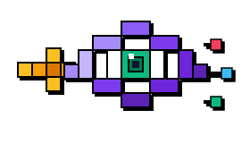
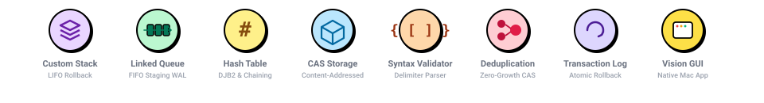

<p align="center">
  
  <h1 align="center">Vision</h1>
  <p align="center"><b>Lightweight In-Memory Version Control &amp; Transaction Engine</b></p>
  <p align="center">A high-performance versioning system featuring write-ahead logging, content-addressable storage, and byte-level deduplication — engineered completely from scratch without built-in dictionaries, sets, or queues.</p>
</p>

---

<div align="center">

[](https://python.org)
[](#)
[](#)
[](#)
[-06B6D4?style=flat)](#)
[](#)

</div>

---

# ⚡ _Core Architecture & DSA Primitives_

<div align="center">



</div>

---

## Overview

**Vision** is a standalone version control system designed to demonstrate low-level computer science fundamentals. Operating entirely in memory, it enforces strict algorithmic constraints:

* **Zero Standard Collections**: Absolutely no `dict`, `set`, or `collections.deque` are utilized in the core engine.
* **Pure Pointer-Based Structures**: Stacks and Queues are built using singly linked nodes with atomic pointer manipulations.
* **Content-Addressable Storage (CAS)**: Text snapshots are indexed via a custom Hash Table combining DJB2 and polynomial rolling hashes with separate chaining.
* **Automated Deduplication**: Commits containing duplicate file contents reuse existing memory nodes, achieving zero additional memory overhead.
* **Dual Interface**: Includes both an interactive command-line terminal and a native desktop GUI styled in a Neo-Brutalist aesthetic.

---

## Low-Level Data Structures

### 1. Dual-Stack Transaction Rollback (`dsa_core.Stack`)
* **LIFO Node Architecture**: Implemented with linked `StackNode` elements for strict $O(1)$ operations (`push`, `pop`, `peek`).
* **Transactional State Machine**: Maintains dedicated `undo_stack` and `redo_stack` structures. Every buffer mutation produces a `TransactionRecord` tracking before-and-after states.
* **Delimiter Validator**: Employs stack-based bracket pairing to verify `()`, `[]`, and `{}` equilibrium before any save or stage operation is permitted.

### 2. Write-Ahead Staging Queue (`dsa_core.Queue`)
* **FIFO Linked Queue**: Built with dedicated head and tail pointers for $O(1)$ `enqueue` and `dequeue`.
* **Database WAL Semantics**: Buffers uncommitted file modifications as `StagedChange` records, each labeled with a monotonic Log Sequence Number (LSN) before batch committing.

### 3. Content-Addressable Hash Table (`dsa_core.HashTable`)
* **Custom Hash Functions**:
  * **DJB2**: 64-bit bitwise rolling hash (`hash = ((hash << 5) + hash) + char_code`).
  * **Polynomial Rolling Hash**: Prime base modulo arithmetic to generate unique 40-character hexadecimal content fingerprints.
* **Separate Chaining Collision Resolution**: Bucket array handles collisions through singly linked `HashNode` lists.
* **Dynamic Rehashing**: Automatically doubles capacity and rehashes active nodes when the load factor exceeds 0.75.

---

## Algorithmic Complexity

| Operation | Component | Average Time | Worst-Case Time | Space Complexity |
| :--- | :--- | :---: | :---: | :---: |
| **Stack Push / Pop** | Node-Based Stack | $O(1)$ | $O(1)$ | $O(1)$ |
| **Queue Enqueue / Dequeue** | Linked Queue | $O(1)$ | $O(1)$ | $O(1)$ |
| **Delimiter Validation** | Syntax Stack Parser | $O(N)$ | $O(N)$ | $O(D)$ |
| **Undo / Redo Cycle** | Dual-Stack Rollback | $O(1)$ | $O(1)$ | $O(1)$ |
| **WAL Staging** | Queue Ingestion | $O(N)$ | $O(N)$ | $O(N)$ |
| **HashTable Insert / Get** | Separate Chaining | $O(1)$ | $O(K)$ | $O(1)$ |
| **Content Deduplication** | Fingerprint CAS Check | $O(1)$ | $O(K)$ | $O(1)$ |
| **Checkout Time Travel** | CAS Node Retrieval | $O(1)$ | $O(K)$ | $O(N)$ |

*(Where $N$ is text size in bytes, $D$ is delimiter nesting depth, and $K$ is maximum hash bucket collision chain length with $K \approx 1$.)*

---

## Getting Started

### Prerequisites
* Python 3.10 or later
* macOS, Linux, or Windows

### Running the Native Desktop App
```bash
python3 gui_app.py
```
*(Or launch the compiled standalone bundle `Vision.app` on macOS).*

### Running the Interactive CLI Terminal
```bash
python3 version_engine.py
```

### Running the Comprehensive Test Suite
```bash
python3 -m unittest test_engine.py -v
```

---

## Interactive Command Reference

| Command | Action |
| :--- | :--- |
| `write <text>` | Overwrites active buffer and pushes transaction to undo stack |
| `append <text>` | Appends text to buffer with delta calculation |
| `undo` | Pops last action from undo stack and restores previous buffer |
| `redo` | Reapplies rolled-back action from redo stack |
| `stage` | Validates delimiter syntax and enqueues to Write-Ahead Log |
| `commit <msg>` | Batches staged WAL queue into Content-Addressable Storage |
| `log` | Displays commit timeline with parent links and deduplication badges |
| `checkout <hash>` | Restores working buffer to a historical commit snapshot |
| `diff` | Shows line-by-line differences against latest HEAD commit |
| `status` | Refreshes multi-panel dashboard and memory metrics |
| `demo` | Executes automated end-to-end simulation of all DSA features |
| `exit` | Quits the engine |

---

## Project Structure

```
Vision/
├── dsa_core.py          # Pure Stack, Queue, HashNode, and HashTable implementations
├── version_engine.py    # Transaction rollback, WAL, CAS, and commit graph engine
├── gui_app.py           # Native desktop application bridge (PyWebView)
├── index.html           # Full-viewport Neo-Brutalist dashboard UI
├── test_engine.py       # Exhaustive unit test suite (17 tests)
└── assets/
    ├── logo.svg               # Vision project mark
    └── components_banner.svg  # Subsystems architecture banner
```

---

## License

This project is licensed under the MIT License.
